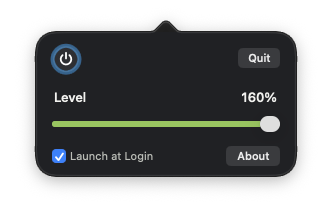

# The Brightening

[](LICENSE)
[](#requirements)

[](https://github.com/drabhikroy/the-brightening/releases/latest)

The Brightening raises the brightness of a MacBook Pro's Liquid Retina XDR
display above the usual limit for everyday content.



Everything runs on your Mac. No account is required and no server is used.
The app makes no network connections.

## What it does

A MacBook Pro with a Liquid Retina XDR display can show HDR highlights far
brighter than the white of an ordinary window. The Brightening lets
everything on screen use some of that extra range. It lives in the menu bar
and is controlled from a small popover.

- **A power button.** Turns the boost on and off. The display goes back to
  normal the moment it is off.
- **A level slider.** Sets the boost from 100 to 160 percent. The app
  remembers the level between launches.
- **Recovery on its own.** Sleep, display changes, and other apps can reset
  the display. The app checks once a second and puts the boost back.
- **Launch at Login.** Optional, and available once the app is in the
  Applications folder.

## What it does not do

It works only on the built-in display. External displays, including the Pro
Display XDR, are left alone.

It does not change HDR video or photos, which already use the extended range.
It does not save any change to your display profile. Quitting the app, or
turning the boost off, puts the display back exactly as it was.

## Requirements

- A MacBook Pro with a Liquid Retina XDR display, which means a 14 inch or
  16 inch model with Apple silicon from 2021 or later
- macOS 27 or later

On other Macs the app opens but has nothing to boost.

## Install

1. Download `The-Brightening-1.0.0.pkg` from the
   [latest release](https://github.com/drabhikroy/the-brightening/releases/latest).
2. Open it and follow the steps. macOS asks for an administrator password
   because the app goes into the Applications folder.
3. The app opens when the installer finishes. Look for the sun rising out of
   a screen in the menu bar.

Installing a newer version over an older one quits the running copy first and
opens the new one afterward.

### Checking the download

`SHA256SUMS.txt` is published with each release. Put it in the same folder as
the package and run this command.

```bash
shasum -a 256 -c SHA256SUMS.txt
```

### Removing The Brightening

1. Open the popover and clear **Launch at Login** if it is on.
2. Click **Quit**. The display goes back to normal.
3. Move The Brightening from the Applications folder to the Trash.

To have macOS forget the install record as well, run this command.

```bash
sudo pkgutil --forget com.abhikroy.thebrightening.pkg
```

## Using The Brightening

1. Click the menu bar icon to open the popover.
2. Click the round power button to turn the boost on or off.
3. Drag the **Level** slider to set how bright the screen gets.

Right-click or Control-click the menu bar icon for **About The Brightening**
and **Quit The Brightening**. The About window gives the version, the
license, and a link to the latest release. The same window opens from the
**About** button in the popover.

## Your data

The app makes no network connections. Links in the About window open your
browser only when you click them.

| What the app writes | Where | How long it stays |
| --- | --- | --- |
| Whether the boost is on, and the level | The app's private preferences | Until you remove the app |
| The login item, when turned on | macOS login items | Until you turn it off |
| The display brightness boost | The display's gamma table, in memory | Until the app quits or the boost is turned off |

The installer keeps a small note for itself while it runs, recording whether
the app was open, so it can quit it first and open the new copy afterward. The
note is in a folder only the system can write to and is deleted before the
installer finishes.

## Accessibility

- **VoiceOver.** The power button reads as a checkbox named The Brightening,
  with its on or off state. The slider is named Level and reads its value as
  a percentage. Launch at Login, About, and Quit are standard controls.
- **Keyboard.** With keyboard navigation turned on in System Settings, the
  power button takes focus with Tab, shows a focus ring, and toggles with
  Space.
- **Reduce Motion.** The power button changes state at once, without its
  press animation.
- **Contrast.** Text and the slider fill meet WCAG 2.2 AA contrast in light
  and dark appearance, and so does the dimmed power symbol when the boost is
  off.
- **More than color.** An off boost shows a raised button, a dimmed symbol,
  and a faded, disabled slider, not only a change of color.
- **Menu bar.** The icon is a template image, so macOS draws it to match a
  light or dark menu bar and Increase Contrast.

## How it works

macOS raises a display above standard white only while something on screen
asks for extended range. The app opens a one point window in the bottom left
corner of the screen whose single pixel is brighter than white. That small
request is enough for the system to open the headroom.

With the headroom open, the app writes a new gamma table to the built-in
display. The table is a straight ramp from black up to the level you chose,
so black stays black and every other value is scaled evenly. Values above
standard white land in the extended range instead of clipping.

A watchdog checks the display once a second. If the headroom closes, the app
opens it again. If something else resets the table, the app writes it again.

Putting the display back resets the gamma of every display, not only the
built-in one, because macOS offers no way to reset a single display. An
external display tinted by another app may need that app to tint it again.

## For developers

### Project layout

| Path | Holds |
| --- | --- |
| `Sources/` | The app, in plain AppKit with no Xcode project |
| `Installer/` | The installer scripts, the installer window text, and the helper that quits a running copy |
| `Screenshots/` | The picture of the popover used in this README |
| `Assets/` | Icon sources and rendered PNGs. See [Assets/README.md](Assets/README.md) |
| `Scripts/` | The icon generator, the writing gate, and two display diagnostics |
| `build.sh` | Builds and signs the app |
| `build-installer.sh` | Builds the signed, notarized installer package |
| `TheBrightening.entitlements` | The app sandbox entitlement |

### Dependencies

| Task | Needs |
| --- | --- |
| Building | Xcode or the Command Line Tools |
| The writing gate | Python 3 |
| Rebuilding the icons | The `cairosvg` and `Pillow` Python packages |

### Running from source

```bash
git clone https://github.com/drabhikroy/the-brightening.git
cd the-brightening
./build.sh
open "$HOME/Library/Caches/TheBrighteningBuild/The Brightening.app"
```

The app is assembled in `~/Library/Caches/TheBrighteningBuild` rather than in
the repository. A repository in an iCloud synced folder can have extended
attributes added to its files while they are being signed, which breaks the
signature.

`build.sh` passes no optimizer flag and no deployment target to `swiftc`.
The plain build is the one checked on an XDR display, so test on the hardware
before adding either one. Without a target the app requires the macOS version
of the Mac that builds it, and the build writes that version into
`Info.plist`.

### Tests and standards gates

```bash
python3 Scripts/standards_gate.py
```

The gate enforces the house writing rules in [CONTRIBUTING.md](CONTRIBUTING.md).
Continuous integration runs it and compiles the app on every push.

Two scripts help when a change touches the display. `Scripts/Diagnose.swift`
prints the headroom and the gamma table of every display without changing
anything. `Scripts/compare.sh` builds two copies of the repository in turn,
runs each one, and records those readings, so two builds can be compared as
numbers.

```bash
./Scripts/compare.sh /path/to/one/copy /path/to/another/copy
```

### Building distributable packages

```bash
export THE_BRIGHTENING_SIGN_IDENTITY="Developer ID Application: Your Name (TEAMID)"
export THE_BRIGHTENING_INSTALLER_IDENTITY="Developer ID Installer: Your Name (TEAMID)"
export THE_BRIGHTENING_NOTARY_PROFILE="Notarization"
./build-installer.sh
```

The package and `SHA256SUMS.txt` land in `dist/`. The version comes from
`build.sh` alone, and the installer reads it back from the finished app.

Without the three variables the script builds an unsigned package for local
testing.

### Code signing and verification

The app is signed with a Developer ID Application certificate and the
hardened runtime. The package is signed with a Developer ID Installer
certificate, then notarized and stapled. Create the notary profile once.

```bash
xcrun notarytool store-credentials "Notarization"
```

To check a finished package, run these commands.

```bash
pkgutil --check-signature dist/The-Brightening-1.0.0.pkg
spctl --assess --type install --verbose=2 dist/The-Brightening-1.0.0.pkg
```

## Contributing

Conventions and house writing rules are in [CONTRIBUTING.md](CONTRIBUTING.md).
To report a security problem, see [SECURITY.md](SECURITY.md).

## Releases

Each release lists its changes in [CHANGELOG.md](CHANGELOG.md). The installer
and `SHA256SUMS.txt` are on the
[Releases](https://github.com/drabhikroy/the-brightening/releases) page.

## License

[PolyForm Noncommercial License 1.0.0](LICENSE). The full text is also at
<https://polyformproject.org/licenses/noncommercial/1.0.0>.

Personal use, personal study, hobby projects, teaching, academic research, and
use by charitable, educational, nonprofit, public research, public health, and
government organizations are permitted. Commercial use is not permitted without
a separate license.

Required notice: Copyright 2026 Abhik Roy.
